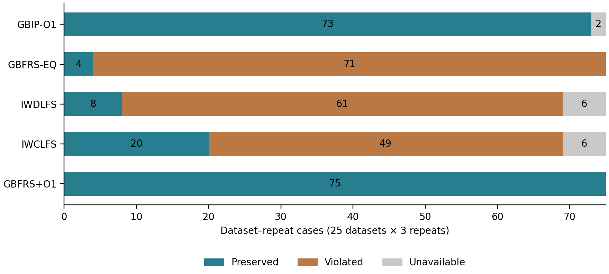
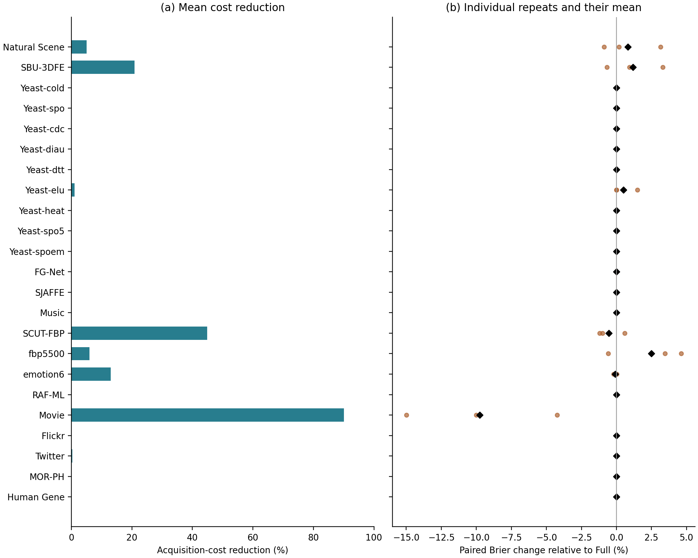

## Experimental evaluation

### Datasets and common evaluation protocol
We evaluate attribute reduction on 25 native label distribution learning datasets spanning scene annotation, facial expression, aesthetics, emotion recognition, gene expression and biological aging. The ten Yeast conditions share their feature matrix and describe distinct labeling conditions; they are interpreted as a related benchmark family. M2B is reported separately as a predictor-suitability boundary case.

Each dataset has three predetermined training/test splits shared by all methods. The original Natural Scene, SBU-3DFE and Yeast-cold splits contain 192 training and 256 test objects. For the added datasets, the training size is $\min(192,\lfloor0.75N\rfloor)$ and the test size is $\min(256,N-n_{\rm train})$. SJAFFE therefore uses 159/54 objects, Music 192/168, and Painting 192/88. The remaining added datasets use 192/256. Objects outside these subsets do not participate in the corresponding run. Dataset coverage and training-sample scale are consequently distinct aspects of this evaluation.

Attribute costs are simulated positive integers from 1 to 10, held fixed across repeats of each dataset. The original cost vectors are retained for the three initial datasets; the added datasets use a common deterministic generation rule. Label vectors are normalized to unit sum, and finite numerical attributes are retained, including constant columns. Predictive preprocessing is fitted exclusively on the relevant fitting partition.

GBIP-O1 fits its information geometry once per training split and starts reduction from the full attribute set. All deletions use the same full-set error vector and the objectwise tolerance $10^{-12}$. The representation settings are $\beta=1$, $\zeta=0.1$, $s_{\min}=2$, $\kappa=0.1$ and $\alpha=1$, with at most 256 alternative seed-pair attempts per node. Complete cost-ordered deletion passes terminate at an unchanged pass; each retained-attribute deletion is checked independently. No predictive loss enters this selection rule.

### Comparators and outcome measures
The published-method comparison comprises GBFRS, IWDLFS and IWCLFS [GBFRS 2023; Zhao et al. 2026]. GBFRS-EQ is an equation-based reconstruction with the disclosed neighborhood interpretation. Its 200-combination grid is $\alpha\in\{0.05,0.15,\ldots,0.95\}$ and $\beta\in\{7,9,\ldots,45\}$. The selected prefix contains the floor of 40%, 30% or 20% of attributes for dimensions up to 100, 500 or 1000, respectively. Movie has 1869 attributes; its 373-attribute output uses an explicitly extended 20% rule. The primary IW implementations restore the label-distance normalization factor in the published definition while retaining the remaining released selection logic. Each method selects its own $\lambda\in\{0.1,0.2,\ldots,0.9\}$. The original reconstruction conventions and source versions are documented with the implementation.

All predictive parameter choices minimize object-weighted Brier error on three training-internal folds. Feature scaling and selector statistics are refitted within each fitting fold. Exact ties favor the smaller $\alpha$, then smaller $\beta$, or smaller $\lambda$. Final selections are fixed before a separate held-out evaluation. The same training-min--max five-neighbor predictor is applied to every selected subset, using stable distance ties and mean neighbor label distributions. Empty predicts the training label mean. Brier error is the primary predictive measure; total variation, KL divergence and Jensen--Shannon divergence are supplementary measures.

The original outputs and a common-preservation comparison answer different questions. We separately evaluate the least-cost prefix of the full GBFRS-EQ ranking that satisfies the same objectwise reference as GBIP-O1, denoted GBFRS+O1. All prefixes are checked without further deletion. The purity-shortcut interpretation at the primary GBFRS parameters, the fixed IW $\lambda=0.8$ outputs and the released-distance IW variants are retained as sensitivity configurations. These outputs are not merged by selecting whichever performs best on the test set.

### Acquisition cost and objectwise preservation
| Dataset | GBIP-O1 | GBFRS-EQ paper quota | IWDLFS paper CV | IWCLFS paper CV | GBFRS+objectwise prefix |
|---|---|---|---|---|---|
| Natural_Scene | 95.00% | 28.44% | 71.54% | 94.30% | 100.00% |
| SBU_3DFE | 79.17% | 29.16% | 87.21% | 98.45% | 99.93% |
| Yeast_cold | 100.00% | 36.22% | 3.15% | 35.43% | 100.00% |
| Yeast_spo | 100.00% | 35.17% | 64.57% | 52.49% | 100.00% |
| Yeast_alpha | -- | 39.37% | 3.15% | 100.00% | 44.62% |
| Yeast_cdc | 100.00% | 38.06% | 3.15% | 35.43% | 100.00% |
| Yeast_diau | 100.00% | 37.53% | 97.90% | 52.49% | 81.10% |
| Yeast_dtt | 100.00% | 42.78% | 93.96% | 100.00% | 100.00% |
| Yeast_elu | 98.95% | 41.21% | 3.15% | 55.64% | 100.00% |
| Yeast_heat | 100.00% | 39.63% | 65.09% | 3.15% | 100.00% |
| Yeast_spo5 | 100.00% | 37.01% | 32.02% | 35.43% | 100.00% |
| Yeast_spoem | 100.00% | 39.63% | 65.35% | 67.72% | 100.00% |
| FG-Net | 100.00% | 29.86% | 30.69% | 72.26% | 100.00% |
| SJAFFE | 100.00% | 29.81% | 82.33% | 95.36% | 100.00% |
| Music | 100.00% | 31.78% | 69.77% | 52.66% | 100.00% |
| Painting | -- | 27.60% | -- | -- | 66.67% |
| SCUT_FBP | 55.09% | 29.86% | 0.24% | 99.84% | 100.00% |
| fbp5500 | 93.99% | 19.35% | 89.08% | 90.98% | 100.00% |
| emotion6 | 87.03% | 30.54% | 64.42% | 63.91% | 99.76% |
| RAF_ML | 100.00% | 31.12% | 0.34% | 0.34% | 100.00% |
| Movie | 9.88% | 20.34% | -- | -- | 99.67% |
| Flickr | 100.00% | 30.17% | 43.48% | 91.56% | 100.00% |
| Twitter | 99.66% | 27.24% | 46.41% | 63.53% | 100.00% |
| MOR-PH | 100.00% | 31.96% | 0.34% | 0.34% | 100.00% |
| Human_Gene | 100.00% | 36.83% | 34.50% | 90.68% | 100.00% |
GBIP-O1 returns a nondegenerate reduction output in 73 of the 75 main dataset--repeat cases. All 73 outputs satisfy the specified objectwise condition. One repeat each of Yeast-alpha and Painting has a degenerate full-set reference and is reported without a reduction output. Complete three-repeat means are therefore available for 23 main datasets.

Among these 23 datasets, eight permit a lower mean acquisition cost and fifteen retain the full-set cost. The largest saving occurs on Movie (90.12%), followed by SCUT-FBP (44.91%) and SBU-3DFE (20.83%). Savings are 12.97% on emotion6, 6.01% on fbp5500, 5.00% on Natural Scene, 1.05% on Yeast-elu and 0.34% on Twitter. The results show a strong dependence on the fitted representation: redundant acquisition is removable on some datasets, whereas the specified single-deletion search retains every attribute on others.

The original published-selector outputs generally acquire fewer attributes, but their objectives differ from the fixed objectwise requirement. GBFRS-EQ satisfies that requirement in 4/75 main cases, IWDLFS in 8/69 valid cases, and IWCLFS in 20/69 valid cases. The separately wrapped GBFRS+O1 output satisfies it in all 75 cases. These counts characterize compatibility with the common reference, rather than failure rates under the original methods' own objectives.

### Downstream prediction and the cost--preservation trade-off
| Dataset | Full | Empty | GBIP-O1 | GBFRS-EQ paper quota | IWDLFS paper CV | IWCLFS paper CV |
|---|---|---|---|---|---|---|
| Natural_Scene | 0.24528 | 0.30422 | 0.24675 | 0.23767 | 0.25345 | 0.25132 |
| SBU_3DFE | 0.03115 | 0.03227 | 0.03148 | 0.03068 | 0.03137 | 0.03098 |
| Yeast_cold | 0.00771 | 0.00655 | 0.00771 | 0.00766 | 0.00773 | 0.00767 |
| Yeast_spo | 0.00956 | 0.00792 | 0.00956 | 0.00947 | 0.00950 | 0.00945 |
| Yeast_alpha | 0.00076 | 0.00064 | -- | 0.00075 | 0.00076 | 0.00076 |
| Yeast_cdc | 0.00106 | 0.00092 | 0.00106 | 0.00107 | 0.00107 | 0.00106 |
| Yeast_diau | 0.00419 | 0.00363 | 0.00419 | 0.00414 | 0.00417 | 0.00416 |
| Yeast_dtt | 0.00340 | 0.00309 | 0.00340 | 0.00348 | 0.00343 | 0.00340 |
| Yeast_elu | 0.00108 | 0.00091 | 0.00109 | 0.00107 | 0.00110 | 0.00109 |
| Yeast_heat | 0.00506 | 0.00441 | 0.00506 | 0.00497 | 0.00507 | 0.00512 |
| Yeast_spo5 | 0.02267 | 0.01879 | 0.02267 | 0.02128 | 0.02163 | 0.02163 |
| Yeast_spoem | 0.02778 | 0.02564 | 0.02778 | 0.02774 | 0.02879 | 0.02861 |
| FG-Net | 0.08668 | 0.07519 | 0.08668 | 0.08150 | 0.07551 | 0.08700 |
| SJAFFE | 0.01852 | 0.02854 | 0.01852 | 0.02202 | 0.01909 | 0.01881 |
| Music | 0.02612 | 0.02093 | 0.02612 | 0.02455 | 0.02527 | 0.02384 |
| Painting | 0.14665 | 0.13376 | -- | 0.14330 | -- | -- |
| SCUT_FBP | 0.15590 | 0.13538 | 0.15511 | 0.15752 | 0.13871 | 0.15637 |
| fbp5500 | 0.06766 | 0.16142 | 0.06932 | 0.06405 | 0.06683 | 0.06812 |
| emotion6 | 0.20804 | 0.18777 | 0.20785 | 0.20936 | 0.21338 | 0.21285 |
| RAF_ML | 0.20525 | 0.24233 | 0.20525 | 0.18498 | 0.20816 | 0.20816 |
| Movie | 0.04863 | 0.04554 | 0.04387 | 0.04586 | -- | -- |
| Flickr | 0.25063 | 0.22598 | 0.25063 | 0.24809 | 0.25450 | 0.25066 |
| Twitter | 0.23219 | 0.20585 | 0.23220 | 0.22474 | 0.22963 | 0.23639 |
| MOR-PH | 0.07911 | 0.07586 | 0.07911 | 0.07123 | 0.05723 | 0.05723 |
| Human_Gene | 0.01741 | 0.01473 | 0.01741 | 0.01767 | 0.01756 | 0.01742 |
Across the 23 datasets with complete GBIP-O1 means, its mean Brier error is lower than Full on three datasets, higher on five, and equal on fifteen. Movie combines the largest cost saving with a decrease from 0.04862950 to 0.04386832. Mean Brier also decreases on SCUT-FBP and emotion6. Natural Scene, SBU-3DFE, fbp5500, Yeast-elu and Twitter instead exchange lower acquisition cost for a higher mean predictive error. The fifteen cost ties correspond to retaining the full set and therefore reproduce the full-set predictions.

The distinction from prediction-oriented selection is visible in the published-method comparison. On sixteen of these 23 datasets, the original GBFRS-EQ output has both lower mean cost and lower mean Brier error than GBIP-O1. The objectwise condition constrains the fitted training reconstruction rather than the neighbor predictor applied to new objects. Preserving every training object's reference error is consequently not equivalent to maximizing predictive accuracy.

### Unavailable outputs and sensitivity reporting
The IW implementations produce nonfinite released information weights on Painting and Movie. Both methods consequently have no valid CV-selected output on those datasets, and their fixed-parameter configurations retain the same explicit status. Such cases are kept in the coverage records and are not assigned zero cost or zero error. The two degenerate GBIP-O1 cases are likewise retained without averaging the remaining two repeats as a complete three-repeat result. Supplementary tables provide every configuration, standard deviation and status, while M2B remains a separately identified boundary case.

## Discussion

The principal empirical distinction is between economical preservation of a specified distributional representation and economical prediction. GBIP-O1 offers the former: every accepted deletion preserves a fixed training-object reference, and complete passes certify a single-deletion endpoint. The range from substantial Movie savings to full-set retention on fifteen datasets shows that the constraint can be selective as well as restrictive. Full-set retention characterizes the achieved endpoint under the stated construction and does not establish global optimality.

A useful reference also matters. The full-set representation includes a global fallback for objects outside eligible leaves, and a positive dependency alone does not establish adequate local coverage. The degenerate references and the predictive strength of Empty on several datasets motivate reporting reference quality alongside acquisition savings. They do not justify changing the reference or omitting difficult datasets after observing the outcomes.

The common-preservation wrapper helps separate the choice of a selector from the choice of an admissibility condition. Original outputs describe their own cost--prediction behavior; GBFRS+O1 describes what its ranking can achieve when subjected to the fixed objectwise condition. A ranking-prefix family and complete-sweep deletion explore different subset families, so the comparison identifies practical endpoints rather than an exhaustive search-space ordering.

The evaluation covers multiple datasets but uses capped training samples, one simulated cost vector per dataset and three descriptive repeats. The shared Yeast feature matrix limits the interpretation of that family's size as independent domain diversity. Several datasets and partitions were examined during development, and the unified learner and reconstructed baselines differ from the original papers' full experimental settings. These considerations define the scope of the present evidence. Further validation should examine training-size and cost-distribution variation and independently held-out data.
